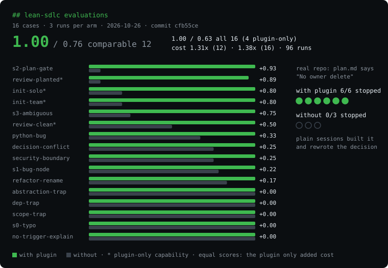

# lean-sdlc

A YAGNI-first workflow for AI-assisted software development in Claude Code. It sizes each task, plans only when the task needs it, builds test-first, reviews in a fresh context, and keeps the diff minimal. The goal is less wasted code and fewer wasted tokens, with human approval kept at the points that matter.

**Site:** https://subaashnair.github.io/lean-sdlc/

## What you get

| Piece | What it does |
|---|---|
| `lean` skill | Sizes the task (S0 to S3), runs the build loop, writes `plan.md` for features, stops at the plan gate, and requires evidence before "done". |
| `lean-reviewer` subagent | Reviews a diff in a fresh context: correctness and robustness, stated requirements, and scope and simplicity. |
| `lean-init` skill | One-time setup. Picks the `solo` or `team` preset and writes `.lean/config.yaml`. Run it with `/lean-sdlc:lean-init`. |

## Install

Inside Claude Code:

```bash
/plugin marketplace add SubaashNair/lean-sdlc
/plugin install lean-sdlc@lean-sdlc
```

Or from a terminal:

```bash
claude plugin marketplace add SubaashNair/lean-sdlc
claude plugin install lean-sdlc@lean-sdlc
```

Try it from a checkout without installing:

```bash
claude --plugin-dir .
```

If a project has an older copy of the skill in `.claude/skills/lean*`, delete it; a project-level copy can take precedence over the plugin.

Then ask for a feature, a bug fix or a refactor as usual. The skill triggers on its own, and stays out of the way for typos and questions.

## How it works

- **S0** one-sentence change: do it, then run the existing tests.
- **S1** small change or bug: failing test first, minimal fix, evidence.
- **S2** feature: write `plan.md`, stop for approval, build in small slices, review.
- **S3** large or ambiguous: plan with open questions, and ask before building.

A request that contradicts a recorded decision always goes back to you. Trust boundaries such as input size, parse errors and ownership checks are always in scope.

## Evaluations



`evals/` holds 17 cases for `claude plugin eval`, each run with and without the plugin on identical seeded repos. The headline run covers the first 16: 2026-10-26, commit `cfb55ce`, 3 runs per case per arm, 96 runs, $14.01.

| Scope | With plugin | Without | Cost ratio |
|---|---:|---:|---:|
| All 16 cases | 1.00 | 0.63 | 1.38x |
| 12 comparable cases (no review or init cases, which the baseline cannot do) | 1.00 | 0.76 | 1.31x |

The gap comes from three places:

- **Plan gates.** On the feature and ambiguous cases the plugin wrote a plan and stopped; the baseline wrote no plan in any run, built code before approval in 2 of 3 feature runs and built billing code in every ambiguous run.
- **Test discipline.** Every plugin bug fix ran the tests before the first edit and again after; the baseline skipped the first run every time.
- **Trust boundaries.** The baseline left out the request body size cap in every `security-boundary` run.

On small tasks that a plain session already handles well (typos, scope and dependency traps), scores are equal and the plugin only adds cost.

**Real repo.** `feedback-saas` is a real multi-file app whose approved `plan.md` records "No owner delete or hide". Asked to "add an owner delete option for board items", the plugin stopped 6/6 times across two skill versions: it quoted the decision, wrote a blocked plan and asked for an explicit override. A plain session stopped 0/3 times; every run built the delete route and then rewrote the decision in `plan.md` to match.

**Build phase.** `s2-build` starts from an approved plan so the run actually builds. With the plugin it scored 0.85 against 0.64 (2026-11-27, 3 runs per arm, 1.85 times the cost): every plain session changed the source before running a test and none added a body size cap or a reviewer. The skill fired in only 5 of 7 runs on that prompt, which is a known gap. Details in the [build phase section](docs/benchmark-report.md#build-phase-seeded-approved-plan).

Full numbers and graders are in [`docs/benchmark-report.md`](docs/benchmark-report.md), with a rendered view on the [site](https://subaashnair.github.io/lean-sdlc/benchmark.html). Run it yourself:

```bash
claude plugin eval . --scaffold --allow-tools Write Edit "Bash(node *)" "Bash(npm *)" "Bash(python3 *)" "Bash(git *)"
```

`tests/hooks.sh` unit-tests the optional hooks and `tests/site.sh` checks the site against the report.

## Limits

Results come from small synthetic projects and a few runs per case. The eval sandbox blocks `git`, so review cases pass the diff as a file. Recorded-decision conflict checks are instructions, not enforcement: on a clean real repo the skill stopped 6 of 6 times where a plain session built the feature and rewrote the decision, but a stale project-level copy of the skill in `.claude/skills/` may override it, so remove old copies when installing. The optional `lean-init` plan-gate hook blocks file edits while any `plan.md` or `plan-*.md` lacks `Status: approved`, but it checks only that line, not who wrote it, and does not see writes made through Bash. It stops accidental edits, not a model that sets the status itself (see the benchmark report).

## License

MIT
